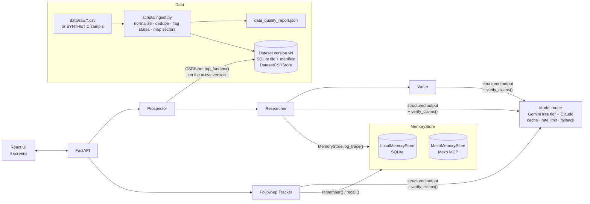
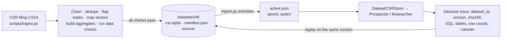

# FundBridge

**FundBridge helps small NGOs find the right CSR funders, pitch them, and follow through, with every claim sourced and every decision explainable.**

Grounded in public data, memory-driven, built for very small NGOs.

> ⚠ The bundled dataset is **SYNTHETIC** (fictional companies, generated numbers). The UI shows a "SAMPLE DATA, not real filings" banner whenever it is in use. Drop real CSR Portal CSVs into `data/raw/` to switch to real data.

> 🔒 **Privacy: demo mode, do not enter confidential data.** FundBridge uses Gemini's **free tier**. Under the [Gemini API terms for unpaid services](https://ai.google.dev/gemini-api/terms), Google may use prompts and responses to improve its products, and human reviewers may read them. FundBridge sends only public CSR filing data and the NGO details typed into the demo form. Do not enter donor lists, beneficiary data, bank details or anything confidential. Use a paid Gemini tier, or `LLM_MODE=cached`, for anything sensitive.

---

## Problem

India's CSR law means thousands of companies publicly report what they spend, where, and on which causes. A two-person NGO in Barmer cannot realistically dig through those filings, work out which companies actually fund *their* cause in *their* state, write a credible pitch, and then remember who promised what three weeks later.

## Solution

The NGO enters its cause, region and a short project description. Four agents take it from there:

| Agent | What it does | What the LLM is allowed to do |
|---|---|---|
| **Prospector** | Maps the cause to a controlled sector list, then runs SQL over CSR filings to find companies with spend in that sector and state | Pick sectors from the fixed list only. All numbers come from SQL. |
| **Researcher** | Scores candidates with a deterministic, weighted formula; writes a **decision trace** (inputs, SQL, score components, pairwise "why A beat B", data-quality caveats) | Write the explanation text from pre-computed, numbered facts. Every sentence cites fact ids, which map to filing rows. |
| **Writer** | Drafts a short outreach email in two tones (formal / warm) | Use at most two company facts, verbatim numbers only, address "CSR Team", no invented contacts. |
| **Follow-up Tracker** | Remembers every event (drafted, sent, reply, promise, no reply) across sessions; applies follow-up rules; drafts the next message | Extract promises from replies and draft the follow-up, citing recalled event ids. The *choice* of next step is rule-based. |

## Model layer: a free-tier router (`fundbridge/llm.py`)

Everything goes through one entry point, `session.call(role, system, user, schema)`. It returns a validated pydantic object tagged with the provider and model that actually produced it, or `None`, in which case the evidence-only template is used.

| Role | Primary | Fallback |
|---|---|---|
| prospector, verifier, parser | Gemini FAST (`GEMINI_MODEL_FAST`, default `gemini-3.5-flash-lite`) | none (template / keyword rules) |
| researcher | Gemini MAIN (`GEMINI_MODEL_MAIN`, default `gemini-3.8-flash`); `RESEARCHER_PROVIDER=claude` to prefer Claude | Gemini MAIN |
| writer, followup_draft | Claude (`CLAUDE_MODEL`, default `claude-haiku-5-5`) | Gemini MAIN |

- **JSON:** Gemini uses its structured-output option (`response_schema`). Claude gets a strict JSON-only instruction containing the JSON Schema. Both are validated with pydantic, and invalid JSON is retried once.
- **Fallback chain:** a Claude error, 429, missing credit, refusal, per-run cap (`CLAUDE_MAX_CALLS_PER_RUN`) or daily cap sends the same prompt to Gemini. The output is tagged (e.g. `gemini:gemini-3.8-flash`, "fallback: claude skipped") and the UI shows it. "No credit" and auth errors switch Claude off for the rest of the process.
- **Free-tier survival:** a per-provider rate limiter (`GEMINI_RPM`, `CLAUDE_RPM`) and exponential backoff on 429 (`LLM_MAX_429_RETRIES`). A SQLite response cache (`data/memory/llm_cache.sqlite`) is keyed by `hash(provider, model, system, user, schema)`, so identical calls never hit the API twice. Daily per-provider call counters reset at midnight Pacific to match Gemini's quota day, and the header shows the remaining budget.
- **Batching:** a whole ranking costs **3 Gemini calls**: sector mapping, one call explaining the top 5 funders, and one call verifying all their claims. Ranks 6–20 use evidence-only templates.
- **Modes:** `LLM_MODE=live` (normal), `cached` (replays the cache only, zero API calls, ideal for a live demo after one rehearsal run) and `gemini_only` (never touches Claude).
- **Observability:** every call logs role, provider, model, latency and token counts. The log is attached to the decision trace (and to the Meko trace metadata) and shown under "Model calls this run".

### Cross-model check (`fundbridge/crosscheck.py`)

One model writes, then two checks run:

1. The deterministic `verify_claims()` rejects any number not in the evidence, other companies, invented emails, phones or named people, missing citations, and "first of its kind" claims.
2. **Gemini FAST verifies every claim against the evidence**, with one verdict per claim. A missing verdict counts as a failure.

Any rejection gets one retry with the problems listed. If it is rejected again, the item is marked **"Needs human review"**: the UI shows the evidence-only template plus the rejected AI text and the reasons. Nothing passes silently. Each output carries a status: `verified` (both checks), `rules_only` (the model verifier was unavailable, e.g. rate-limited), `needs_human_review`, or `template`.

## Accounts and roles (NGO · company · donor)

Accounts, sessions, profiles, pitches and the pitch event log live in a relational database (`data/app/platform.sqlite`), never in Meko.

- **Auth:**
  - Argon2 password hashes.
  - A signed `httpOnly` session cookie (`SESSION_SECRET`) backed by a server-side session table, so logout revokes it.
  - A login rate limit (`LOGIN_MAX_FAILURES` per `LOGIN_WINDOW_MINUTES`).
  - Email verification and password reset. In `DEMO_MODE` the links are printed to the server console and a banner says so.
  - A consent and privacy notice at signup.
- **Guards:** every route checks the role: **401** when not logged in, **403** for the wrong role. `ngo_id`, `company_id` and `donor_id` always come from the session, never from the request. A pitch that isn't yours is reported as *not found*.
- **NGO:**
  - Profile with a readiness checklist (CSR-1, Darpan, 12A, 80G, all labelled *self-declared*).
  - An opt-in directory listing (off by default; the NGO chooses which fields to show).
  - Funder search, outreach (copy/mailto, or **Send pitch in app** when the ranked company has an account with the same CIN, after human approval).
  - Follow-ups that read the in-app thread directly (no pasted replies). Nudge rules use the SQLite event log.
  - Supporters (aggregate counts; names only for donors who opted in) and impact updates (the Writer may tidy the NGO's own notes but may not add figures; the NGO approves).
- **Company** (can use the app as soon as it signs up):
  - Profile and CSR footprint joined by CIN (with source rows; "unknown" where missing).
  - NGO directory, **ranked for the company** from its own profile: cause fit 0.50 (NGO causes in its focus sectors), state fit 0.35 (NGO in a focus state), listed registrations 0.15 (CSR-1, 12A, 80G; self-declared). Only fields the NGO chose to list are used; anything not listed, or a focus the company hasn't set, counts as unknown (neutral), never as a penalty. Opt-in NGOs only; NGOs the company reported are hidden for it.
  - Inbox with the **Screener**.
  - Actions: Interested / Need more info / Not a fit, with an optional reply that can carry a promise (what, amount, due date). The reply is drafted by the model, and a person edits and approves it.
  - Pipeline, and *Report unsolicited / block*.
- **Donor** (individuals, minimal data, India / INR only):
  - Discovery shows only NGOs that are listed **and** accept individual donations. The **Matcher** ranks them.
  - Shortlist, follow, and a feed of updates labelled "reported by the NGO".
  - **Give** opens the NGO's own `https` page after a leaving-FundBridge notice.
  - "I donated" self-reports (no payment data). Report-NGO hides that NGO for the reporting donor only.

Each pitch event is written to the SQLite log (the source of truth) and to Meko via `conversation_create` / `conversation_add_message`: one conversation per pitch thread (`session_id = pitch:<id>`), plus private per-NGO, per-company and per-donor conversations, each under its own agent namespace. Screening results go only to the company's private conversation. Nudges go only to the NGO's.

### Screener and Matcher (deterministic scores, Gemini for words)

| Agent | Score (no model involved) | Model's job (Gemini FAST) |
|---|---|---|
| **Screener** (company) | sector fit 0.45, state fit 0.35, ticket fit 0.20, from the pitch's *structured* facts against the company's own criteria. Wording, length and grammar are never scored. | 3-line neutral summary, fact-checked. Advisory only: it never changes a pitch's status. |
| **Matcher** (donor) | cause overlap 0.50, location 0.30, giving-range fit 0.20. Profile wording is never scored. | One batched explanation for the top 5 from computed facts. The donor's private memory is recalled first and cited per recommendation, and each recommendation carries a decision trace. |

Donor features use Gemini only (no Claude credit).

### Verification (automatic checks only)

- **Checks, no external calls:**
  - PAN, CIN and Darpan format regexes.
  - Duplicate-ID detection across accounts.
  - For companies, a CIN join against the ingested CSR filings ("found in CSR filings FY… to FY…", with source rows) plus a name-consistency check.
- **Levels:** `self_declared` → `format_checked` (NGO: valid formats, no duplicate IDs) or `evidence_linked` (company: CIN found in the filings with a matching name). The level is recomputed on every read.
- Nobody checks official records by hand, so the word **"verified" is never shown**; credentials are always labelled *self-declared*. FundBridge never automates or scrapes captcha-protected portals.
- **Reports affect only the reporter:** a company's *Report unsolicited / block* stops that NGO pitching it and hides it from its directory; a donor's report hides the NGO from that donor's recommendations. Nothing is hidden for anyone else.

### Demo accounts (password `demo-pass-2026`, or `DEMO_PASSWORD`)

| Role | Email | Notes |
|---|---|---|
| NGO | team@shiksha-setu.demo.fundbridge.local | listed, accepts donations, has a pitch thread with a promise |
| NGO | team@hara-bhara.demo.fundbridge.local | listed, accepts donations |
| NGO | team@sakhi-collective.demo.fundbridge.local | **not** listed (opt-in demo) |
| NGO | 9 more listed DEMO NGOs (Vidya Jyoti, Swasthya Saathi, Jal Mitra, Udaan Mahila, Annapurna Rasoi, Hasta Kala, Saksham Seva, Green Ganga, Aapda Raksha) | fictional, across 7 states and all sectors; no registration IDs, only self-declared 12A/80G flags for some |
| Company | csr@thar-minerals.demo.fundbridge.local | received the seeded pitch |
| Company | csr@marudhar-power / csr@sahyadri-textiles .demo.fundbridge.local | found in CSR filings (with the real data loaded: unknown) |
| Donor | ananya@donor.demo.fundbridge.local | name shared with NGOs |
| Donor | rohan@donor.demo.fundbridge.local | anonymous by default |

All demo data is labelled **DEMO**. Demo donation pages use the reserved `example.org` domain.

## Architecture



The CSR store and memory sit behind interfaces (`fundbridge/stores/csr_base.py`, `fundbridge/stores/memory_base.py`). There is one CSR store, `DatasetCSRStore`, which always reads the active dataset version. Memory is selected with `MEMORY_BACKEND=meko|local`. If Meko has no credentials or fails its health check, the app falls back to local memory and shows the reason as a warning in the UI header.

### Dataset versions and replay



**Versions.** Every load builds a new, immutable version in `data/processed/datasets/v<N>/`:
- `csr.sqlite`: the tables `clean_projects`, `clean_companies`, `clean_company_year`, `gold_funders_sector_state`, `gold_company_gap` and `fb_meta` (data source + data-quality report);
- `manifest.json`: `dataset_id`, `version`, `sha256` of the source files, REAL or SAMPLE, FY range, row count;
- `source/`: the CSV files exactly as loaded.

`data/processed/datasets/active.json` names the active version. It is replaced atomically (`os.replace`), and older versions are never deleted, so every trace can be replayed on the data it used.

**Data checks** (`validate_database` in `fundbridge/ingest.py`) run on every build and again on activation. A version that fails any check is never created:
- Unique keys: `row_id`, `source_ref`, and each aggregate table's grain.
- No blank CIN where one is expected (non-`NAME:` companies).
- Valid states: rows with one state must name a known Indian state or UT.
- Spend ≥ 0, outlay ≥ 0, and `state_quality` in `ok | multiple | missing`.

`tests/test_datasets.py` injects broken rows and checks that each check catches them.

**Managing versions.** Everything runs from the command line:

```bash
python scripts/ingest.py               # build a new version from data/raw/*.csv (or the sample) and activate it
python scripts/ingest.py --list        # all versions, which one is active
python scripts/ingest.py --activate 2  # switch to v2 (restored if the app cannot read it)
python scripts/ingest.py --rollback    # back to the previously active version
```

The running app picks up a switch on its next request.

**Replay.**
- Each decision trace (and its Meko metadata) records `dataset_id`, `version`, `sha256`, every query's SQL, params, tables, row count and result hash, and the dataset's data-quality caveats.
- `POST /api/runs/{run_id}/replay` (the **Replay** button under Data provenance) re-runs every query on that dataset version and re-ranks with no model calls, even after newer versions were activated.
- It returns **reproduced**, **differs** (with which queries or ranks changed) or **unavailable** (the version is missing, or its file hash no longer matches).

### How Meko is used

`MekoMemoryStore` talks to the Meko MCP server (`https://mcp.mekodata.ai/mcp`) over streamable HTTP with `Authorization: Bearer mko_tkn_…` and uses these documented tools ([reference](https://docs.mekodata.ai/reference/mcp-server/)):

| FundBridge call | Meko tool |
|---|---|
| `remember(event)` | `memory_add`: text summary + `metadata.event` with the full record, `run_id = ngo:company` |
| `recall(ngo, company)` | `memory_search` filtered by agent/run, parsed from metadata |
| `log_trace(trace)` | `artifact_put` (full JSON trace) + `memory_add` (summary pointing at the artifact hash) |
| `search(q)` | `context_search` |

On startup the adapter calls `list_tools` and checks that these tools exist. Every write is also mirrored to the local store, and `recall()` merges both by `event_id`. That way the timeline stays exact, events written by other sessions or agents are pulled in, and the UI keeps working if Meko is briefly unreachable.

## Setup

Requirements: Python 3.11+, Node.js 18+.

```bash
cp .env.example .env          # optional: GEMINI_API_KEY, ANTHROPIC_API_KEY, MEKO_API_KEY
python scripts/demo.py        # or: make demo
```

`scripts/demo.py` creates `.venv`, installs requirements, ingests the data, seeds the demo NGO, installs frontend packages, and starts the API (`:8000`) and UI (`:5173`). It works with **no keys at all** (local stores and offline templates).

Other commands (see `Makefile`):

```bash
make test          # 206 unit/integration tests (no network)
make reset-demo    # re-seed the demo NGO from scratch
make ingest        # build + activate a new dataset version (picks up data/raw/*.csv)
make build         # build the UI; the API then also serves it on :8000
```

**Using real data:** put CSV exports from the National CSR Portal in `data/raw/`. Recognised headers include *Company Name, CIN, Development Area, State, District, Financial Year, Amount Spent (INR)*; see `HEADER_ALIASES` in `fundbridge/ingest.py`. Then run `make ingest`. The badge switches to **REAL**.

A tested source is the MCA company-wise CSR project data mirrored by India Data Portal (`csr-projects-by-companies.csv`, Open Data Commons Attribution licence, FY 2014-15 to 2020-21, amounts in lakhs, which are converted to INR on import). Rows with zero amount spent are dropped and counted in the data-quality report. The demo *company* accounts are fictional, so with real data their CSR footprint shows "unknown". Tests always use the synthetic sample in `data/processed_test/` (`python scripts/ingest.py --sample`), so real data never changes test results.

**Switching memory:** set `MEMORY_BACKEND=meko` with `MEKO_API_KEY`, then restart. Without valid credentials you will see an orange warning and the local fallback in the header.

## Data handling

`scripts/ingest.py` does the following and records every step in the data-quality report shown on the Onboarding screen:

- **Company names:** normalizes case, punctuation, `&`, a leading "The", and suffixes (Ltd / Limited / Pvt / Private / …). Identity is the CIN where any row of that name has one, else the normalized name. Original spellings are kept and counted ("merged from 3 variants").
- **Duplicates:** removes exact duplicate rows.
- **States:** never guessed. Each row gets `state_quality = ok | multiple | missing`. Multi-state and PAN India rows are kept but are **not** attributed to any single state. Their amounts are shown separately ("not counted towards Rajasthan").
- **Sectors:** mapped to a controlled list through an ordered keyword table (`fundbridge/sectors.py`). Unmatched labels become `other` and are counted.
- **Provenance:** every row keeps `source_ref = <file>#L<line>|FY<year>`. Every sourced chip in the UI opens the original rows.

## Scoring (deterministic, weights in `fundbridge/config.py`)

| Component | Weight | Definition |
|---|---|---|
| sector_match | 0.35 | share of the company's CSR spend (window) in the NGO's sectors |
| state_match | 0.25 | share of that sector spend in the NGO's state (single-state rows only) |
| district_overlap | 0.10 | 1 if any recorded spend in the NGO's district |
| consistency_over_years | 0.15 | financial years with sector+state spend ÷ years in window |
| ticket_size_fit | 0.15 | `1 − |log10(avg ticket / ask)| / 2`, floored at 0 (same size → 1, 10× apart → 0.5) |

## Demo script (~3 minutes)

0. **Before the demo:** run the whole script once with `LLM_MODE=live`, then restart with `LLM_MODE=cached`. Every model response is replayed from the cache, with zero API calls and no rate-limit surprises on stage.
1. **Header (10 s).** Point out the badges: the dataset (`CSR filings v1 · SAMPLE · FY range · rows`), `Memory: local|Meko`, `LLM mode`, and the Gemini/Claude budget left today. Mention the privacy strip (free tier, no confidential data). Then the amber banner: this is synthetic data, and the app says so.
2. **Onboarding (30 s).** Click **Load demo NGO** (Shiksha Setu Foundation, education, Barmer, Rajasthan, ₹15 lakh ask). Show the data-quality report on the right: duplicates removed, rows with missing or multiple states, name variants merged. Click **Find funders**. It returns in well under a second offline.
3. **Ranked funders: live decision trace, A vs B (75 s).** Open **#1** (Thar Minerals in offline mode). Walk through:
   - score bars and weights ("no LLM in scoring");
   - "Why" sentences, each with a sources chip → click one → the actual filing rows, raw spelling and line numbers;
   - **"Why this outranked Aravali Cements"**: Thar 75.6 vs 70.8. It is ahead on sector focus (+6.9) and consistency (5 of 5 years, +3.0), and behind on state focus (−2.6) and ticket-size fit (−2.6), because Aravali's typical project size is closer to a ₹15 lakh ask;
   - **Unknown** list (contact person, current policy, budget) and company-specific caveats (name variants, rows with missing state);
   - the exact SQL and parameters used.
   (With a Gemini API key the Prospector may also map the cause to *rural development*, and the order of the top two can flip. The trace explains whichever way it goes.)
4. **Outreach (30 s).** Click **Draft email** on a company. Show the formal/warm toggle, the "facts used" list with source chips, the yellow "contact details not in public data" note, the word count, Copy and Open in email app, and that **Mark as sent** requires ticking "I reviewed this and sent it myself".
5. **Follow-ups (35 s).** Thar Minerals shows **OVERDUE → gentle nudge** (sent 9 days ago, no reply). Aravali Cements replied with "will review … by <date>". The tracker extracted a promise and suggests **wait until** that date. Click **Draft it**. Paste a new reply to show live promise extraction.
6. **Persistence (10 s).** Stop the server (Ctrl+C), run `python scripts/demo.py` again, and reopen Follow-ups. The same history is recalled from memory.

## Honesty rules (enforced in code)

- Every ranked row has at least one `source_ref`. Every explanation sentence and email fact links to rows. Statements about the *absence* of data cite the dataset query.
- Missing information is shown as the literal word **unknown**.
- `verify_claims()` (`fundbridge/verify.py`) rejects ungrounded numbers, other companies, invented contacts, missing citations and banned claims, and retries once. Template fallback otherwise.
- Nothing is sent automatically. Seeded follow-up events are labelled **simulated**.

## Limitations

- **Public data is messy.** Duplicate filings, inconsistent company names, and rows with missing or multiple states are common. We merge, flag and exclude conservatively, but a wrong merge or a missed variant is still possible. Multi-state and PAN India spend is never attributed to a state, which under-counts some companies.
- **No decision-maker contacts.** Filings don't include CSR team emails or names, so emails go to a generic "CSR Team" and the NGO must add the address by hand.
- **Past spend ≠ future intent.** Filings describe what a company spent, not its current priorities, open calls, or remaining budget. All of these are shown as unknown.
- **Sector mapping is coarse.** A keyword table and a small controlled list cannot capture every Schedule VII nuance. Unmapped labels fall into `other`.
- **The scoring weights are a judgement call.** They are transparent and in config, not learned or validated against outcomes.
- **Similar donor-matching tools exist.** FundBridge's angle is source-linked explanations, explicit unknowns and persistent follow-up memory for very small teams, not novelty of matching.
- **The bundled data is synthetic.** Real-data behaviour depends on the exports you load. The Meko adapter is written to its documented interface and covered by tests with fakes. It needs your credentials to exercise live.
- **Free-tier limits are placeholders.** Google publishes free-tier rate limits only in AI Studio. Copy your real `GEMINI_RPM` and `GEMINI_DAILY_LIMIT` from there. The model verifier is itself an LLM: it reduces unsupported claims but is not proof, which is why the deterministic rules run first.
- **Promise extraction is conservative.** Explicit dates are parsed. Vague phrases ("next week") are recorded with a deadline of `unknown` rather than guessed.

## Pan-India coverage and limitations

### Geography (Local Government Directory)
- **Source:** India Data Portal dataset *LGD Codes* (`https://ckandev.indiadataportal.com/dataset/lgd-codes`, ODC-BY), which republishes the Local Government Directory (lgdirectory.gov.in). Files used: `state-lgd-codes.csv` and `district-lgd-codes.csv`, downloaded 01/11/2026 by `python scripts/geo.py fetch`; URLs, download time and sha256 are recorded in `data/raw/geo/SOURCES.json` and in every `geo_version`. The LGD site itself needs a captcha, so it is never automated (a hand-downloaded file can be dropped into `data/raw/geo/`). data.gov.in's LGD resources say no API exists for them.
- **Loaded, not hardcoded:** `python scripts/geo.py load` reads whatever the files contain into `data/processed/geo/geo.sqlite` as a new **geo_version** (old versions are kept). The current file has 38 state/UT rows and 765 districts. Status flags are derived from the data: Daman and Diu and Dadra and Nagar Haveli have no districts and are marked **merged** into The Dadra and Nagar Haveli and Daman and Diu (the merger is in `fundbridge/geo_aliases.csv`). UT vs state comes from `fundbridge/geo_union_territories.json` (Constitution, First Schedule).
- **Strict matching:** LGD code (checked against the name), exact normalised name (districts only inside their own state), or an alias (curated or admin). **No fuzzy matching.** Everything else goes to the admin *unmapped locations* queue. Renames (Allahabad → Prayagraj) map and are flagged `legacy_mapped`; a split district (Bardhaman) keeps the row at state level, flagged `split`; a row whose code and name disagree (e.g. code = Ahmadabad, name = Prayagraj) is flagged `conflict` and gets no district. Buckets ALL_INDIA, MULTIPLE and NOT_SPECIFIED are never reassigned to a state.
- **On the real MCA file:** all single-state rows resolved; districts: 10,796 ok, 303 `code_only` (unusual name, official code used), 331 conflicts left blank, 15,483 without a district; 6,054 rows are All India.

### Multi-region profiles and matching
- NGOs: headquarters + operating areas (districts, whole states or all India). Companies: head office, self-declared operating areas, and CSR focus areas. Projects and calls have their own areas. All live in one `areas` table with LGD codes and the geo_version they were checked against.
- Matching takes the best overlap: **same district 1.0 > same state 0.6 > pan-India 0.3** (`GEO_MATCH_WEIGHTS`). Missing location scores nothing and is shown as "unknown".

### Coverage and fairness
- Every dataset version precomputes state × sector × FY spend and distinct companies, district × sector aggregates, and the share of rows without a district. Coverage per (state, sector) and (district, sector) is **GOOD** (≥ 10 companies and ≥ 3 years; districts ≥ 3 and ≥ 2), **THIN** or **NONE** (`COVERAGE_GOOD*` in config). On the real data: 28 GOOD, 7 THIN, 1 NONE states/UTs (all sectors).
- Every ranking shows its coverage. THIN or NONE adds: "Few filings for this area. Treat results as weak evidence." plus two separately labelled fallback lists, never mixed into the ranking: **funders in similar states** (states with GOOD coverage whose reported sector mix is most similar, by cosine similarity: *similar by data, not by geography*, weight 0.5) and **pan-India funders** (spend filed as All India, weight 0.35).
- Scores are shares, not volumes, and each is shown **raw and relative** to the best match in the NGO's own list.
- The **Coverage** page (public, also a tab for every role) lists every state/UT from the LGD file and each state's districts, including districts with no reported projects: "From reported filings; absent data does not mean no CSR activity."

### Sector taxonomy (Schedule VII)
- `fundbridge/schedule_vii.json` maps each controlled sector to Schedule VII items. Only items read from an official source are marked `verified`: items (i) and (ii), from the India Code extract of Schedule VII. The full official file could not be downloaded from the build machine (India Code refused the connection, MCA returned 403), so the other sectors show "not yet checked against the official text" until a national admin fills them in. FundBridge draws no legal conclusions (for example about the local-area preference).
- Raw filing labels that fall into "other" form the admin's unmapped-sectors queue; a mapping applies from the next dataset version. The loaded dataset has no local-area spend column, so that signal is "unknown".

### Languages and formats
- UI in English and Hindi (`frontend/src/i18n/en.js`, `hi.js`); the other target languages in `I18N_LANGUAGES` need only a translation file. Preference is saved per user.
- **Draft translation only** (`fundbridge/translate.py`, Gemini): names, CIN, CSR-1, Darpan, PAN, amounts, dates and source refs are replaced by placeholders before the model sees the text, then restored; a deterministic check rejects any translation that changes or adds a number, ID or name. Translated text always carries "Machine translated. Review before sending."
- Amounts use lakh/crore grouping (12,34,567) with a header toggle (auto / rupees / lakh / crore; the unit is always shown); dates are DD/MM/YYYY in IST; financial years run April to March. Inter + Noto Sans Devanagari with system fallbacks for other scripts.

### Mobile, low bandwidth, accessibility
- Responsive layout, paginated lists, lazy-loaded screens (main bundle about 85 KB gzipped), installable PWA (`manifest.webmanifest`, `sw.js`: app shell cached, offline API calls show a message). WhatsApp/copy share links carry only the project or draft text.
- Checked with axe-core (WCAG 2 A/AA, serious and critical) on 14 key screens: 0 violations; no horizontal scroll at 390 px or at 200% text size.

### Scale and cost
- Indexes on CIN, state, district, sector and year; coverage and fallback read precomputed tables; a per-version LRU cache serves repeat queries.
- **Load test** (`python scripts/load_test.py`, synthetic data 10× the real file: 330,368 rows, 6,881 fictional companies): every query under its threshold; cold times: ranking 0.75 s, coverage 0.007 s, state table 0.012 s, districts 0.003 s, pan-India funders 0.22 s, similar states 0.04 s, company profile 0.008 s; repeats come from the cache in under 0.12 s.
- Model load: batched explanations, cache by hash, background jobs, per-provider daily caps and a **per-user daily cap** (`LLM_USER_DAILY_CAP`). When a cap is reached, features fall back to templates and the UI says "AI capacity reached for today, try later".

### Regional admins
- Created only with `python scripts/admin.py create EMAIL --states "Rajasthan" --languages hi` (no admin signup). A scoped admin sees only its states' and languages' queue items and feedback; the sector map is national-only. Admins never approve companies or verify NGOs.
- **State CSR portals:** `config/state_portals.json` lists every state/UT, empty unless confirmed. Confirmed so far: West Bengal (csr.wb.gov.in) and Odisha (csr.odisha.gov.in), both opened during the build. A link is shown only when configured; URLs are never guessed.

### Privacy
- The consent notice and data-minimisation rules are unchanged. During the demo, personal data is not stored on free-tier hosting. Demo data stays labelled DEMO.

### Known limitations
- The LGD snapshot is the India Data Portal copy (district file dated 20/10/2023); districts created later are unknown until a newer file is loaded.
- Coverage reflects reported filings only. Thin coverage often means few filings, not little CSR activity.
- "Similar states" are similar by sector mix in the filings, not neighbours: no official adjacency list was available.
- Only two Schedule VII items are verified against official text so far.

## Project layout

```
fundbridge/            backend package
  agents/              prospector, researcher, writer, followup, shared Context
  stores/              CSRStore (DatasetCSRStore: versioned SQLite) and MemoryStore (local SQLite, Meko MCP)
  datasets.py          dataset versions: build, check, activate, roll back
  geo.py               LGD geography: versions, strict resolver, aliases, review queue
  taxonomy.py          sector map + Schedule VII references
  translate.py         draft translation with protected tokens and a deterministic check
  platform/            accounts, profiles, areas, projects/calls/requests, scoped admin, routes
  ingest.py normalize.py sectors.py scoring.py evidence.py verify.py llm.py api.py pipeline.py
scripts/               demo.py, ingest.py, generate_sample.py, seed_demo.py, seed_platform.py
frontend/              React + Vite + Tailwind (4 screens)
tests/                 pytest suite
data/                  raw/ (real CSVs), sample/ (SYNTHETIC), processed/ and memory/ (generated)
```
